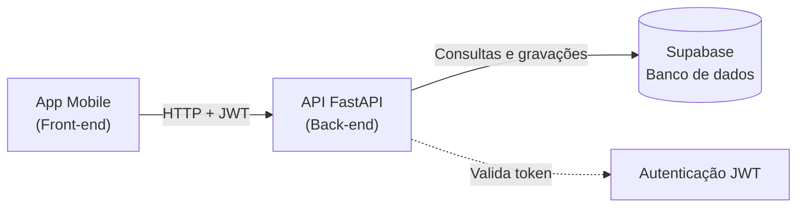
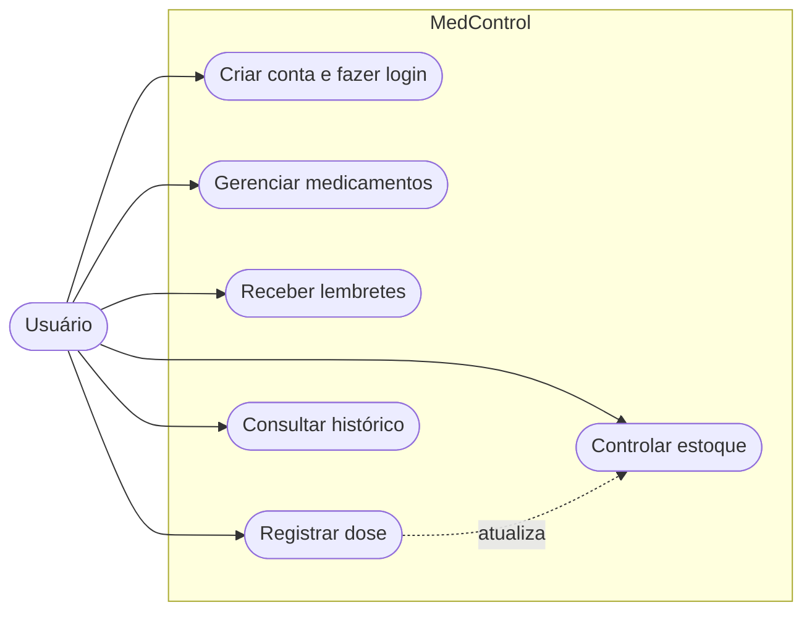
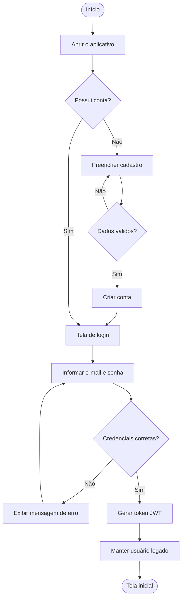
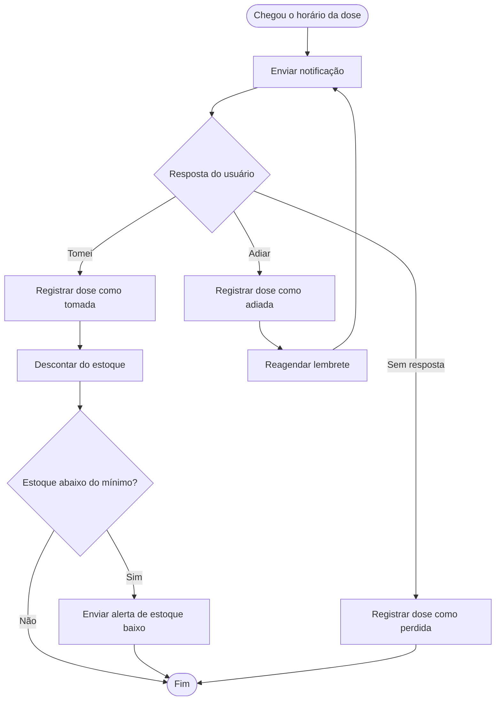
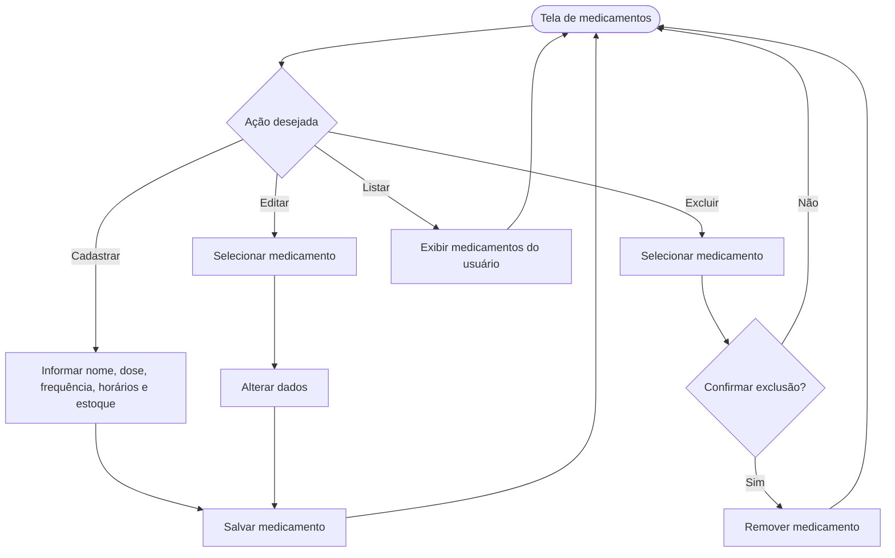
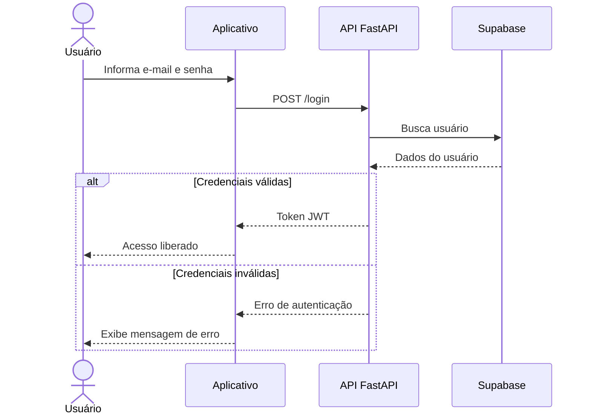
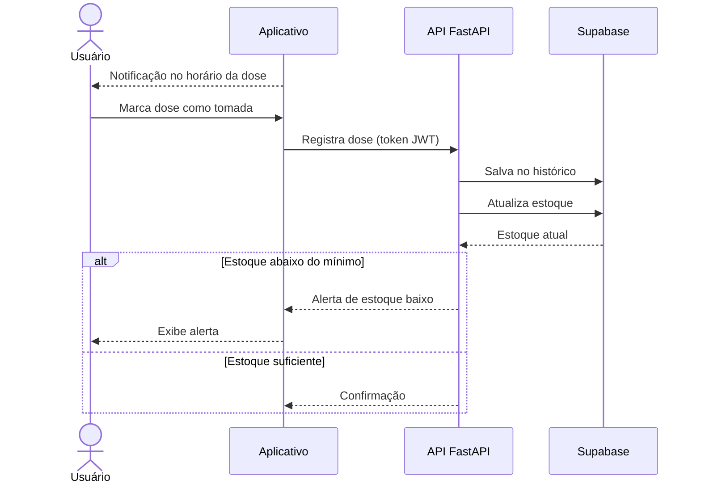
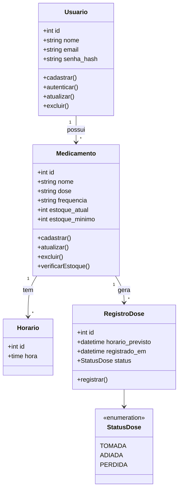
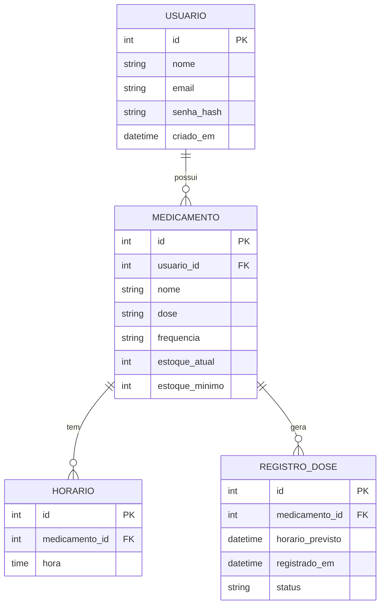

# Diagramas - MedControl

> Fluxogramas e diagramas UML que descrevem o funcionamento, a arquitetura e os dados do aplicativo.

## Arquitetura

## Casos de uso

## Fluxograma: cadastro e login

## Fluxograma: lembrete e registro de dose

## Fluxograma: gestão de medicamentos

## Diagrama de sequência: login

## Diagrama de sequência: registro de dose

## Diagrama de classes

## Modelo entidade-relacionamento

> Os diagramas representam o escopo do MVP. O modo cuidador, as consultas e receitas e as recompensas serão adicionados quando forem desenvolvidos.
