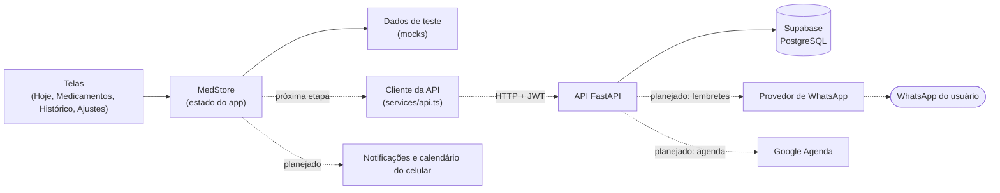
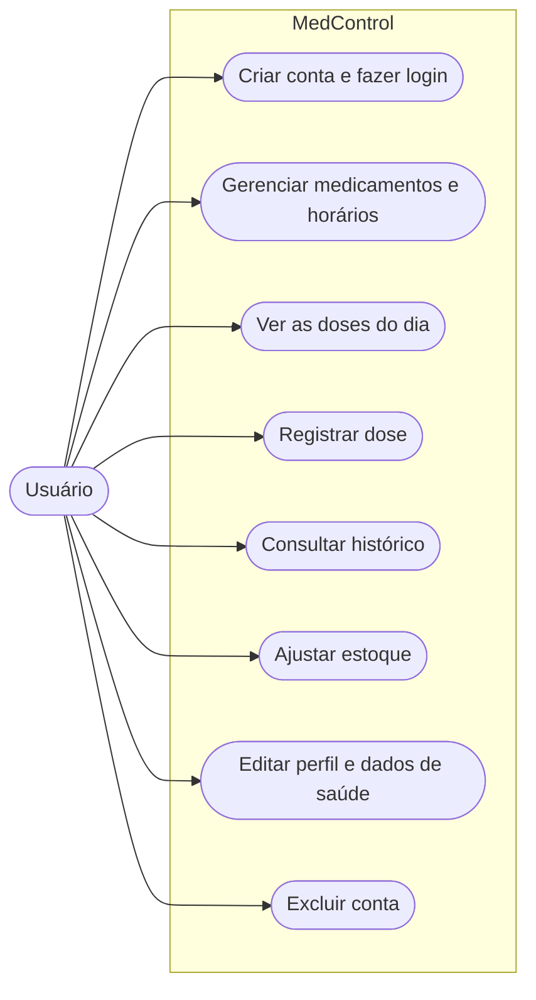
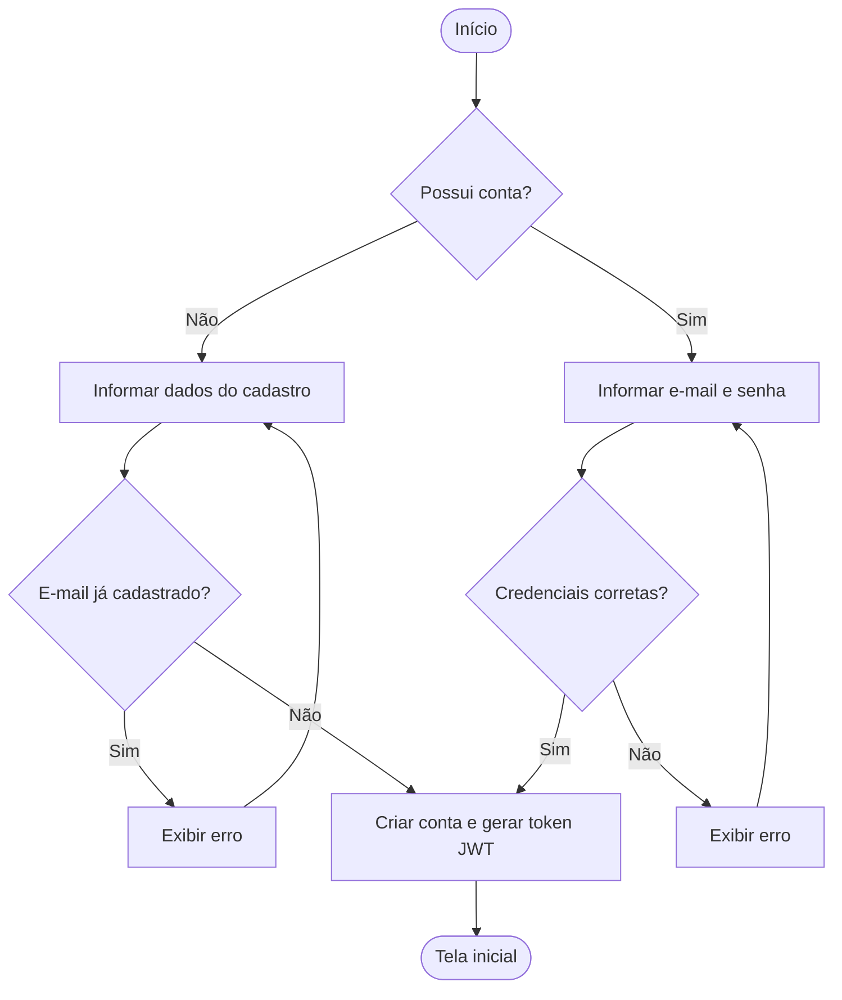
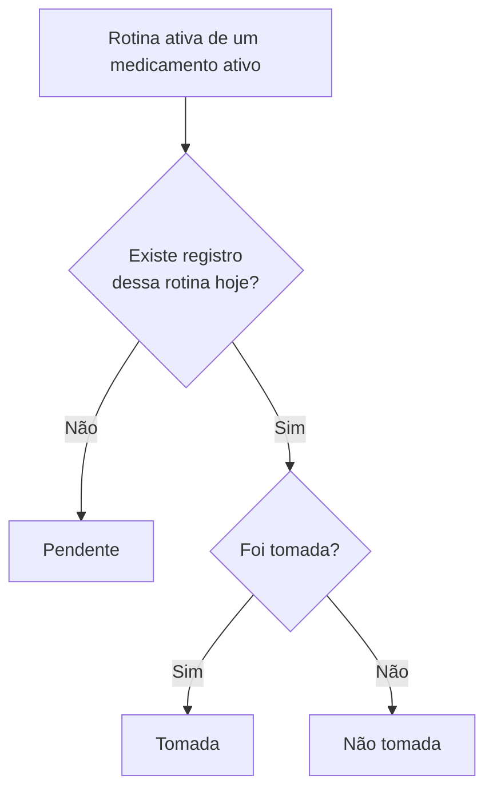
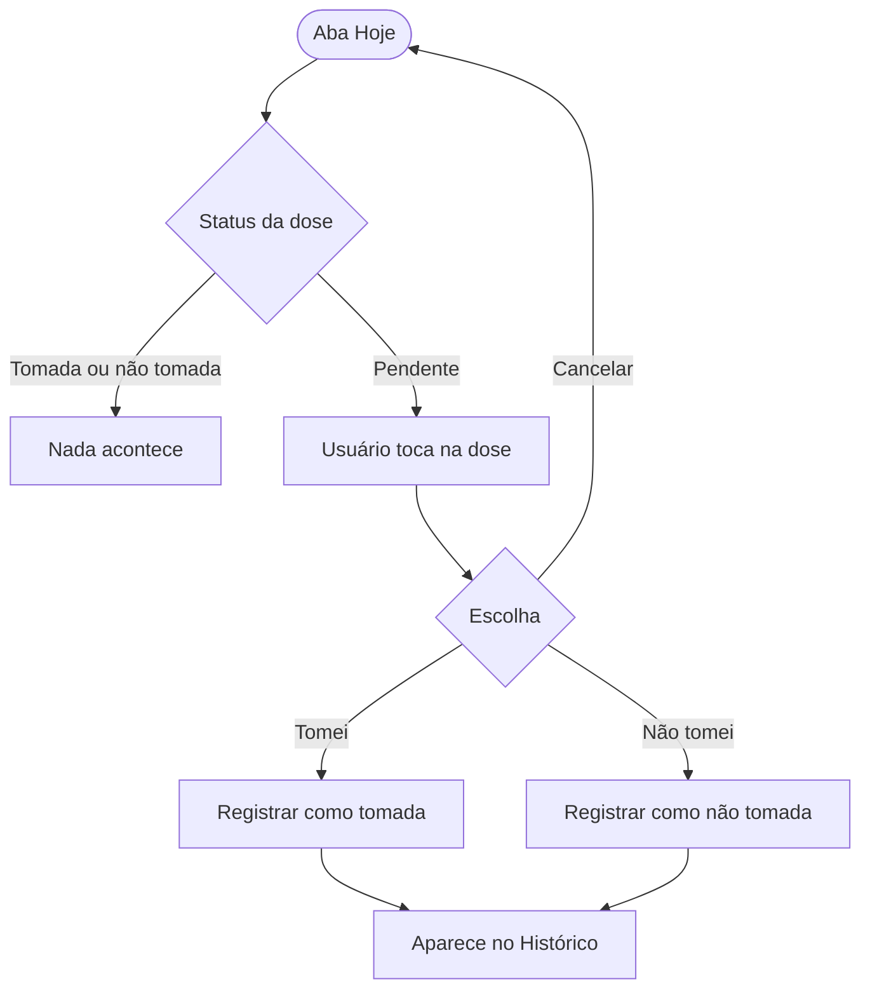
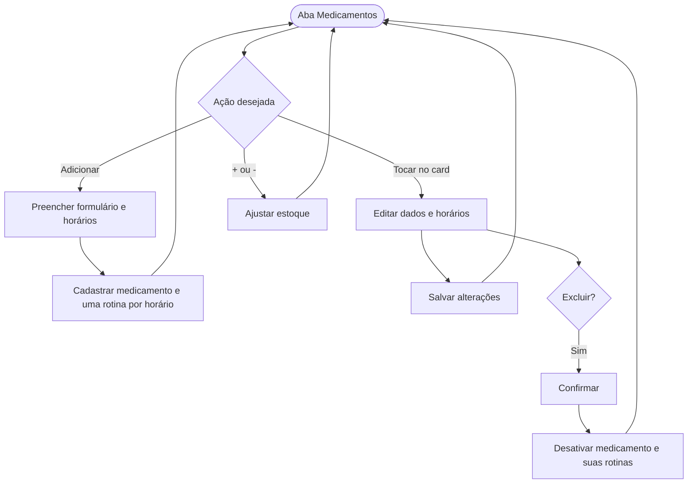
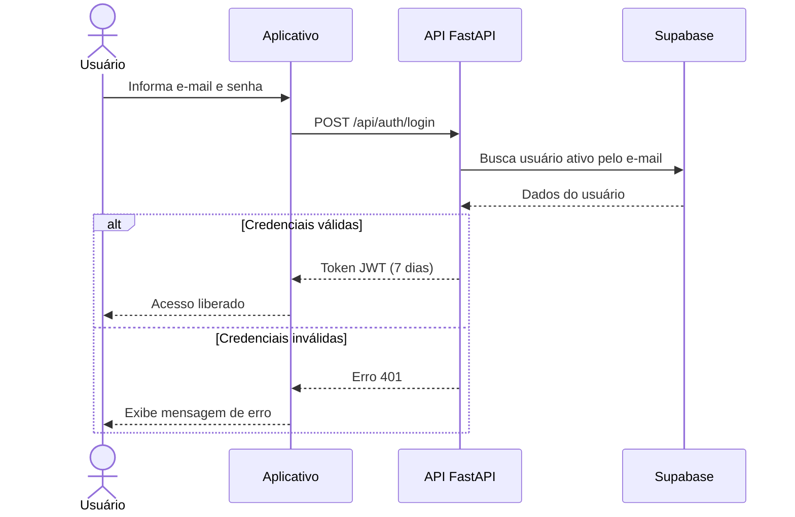
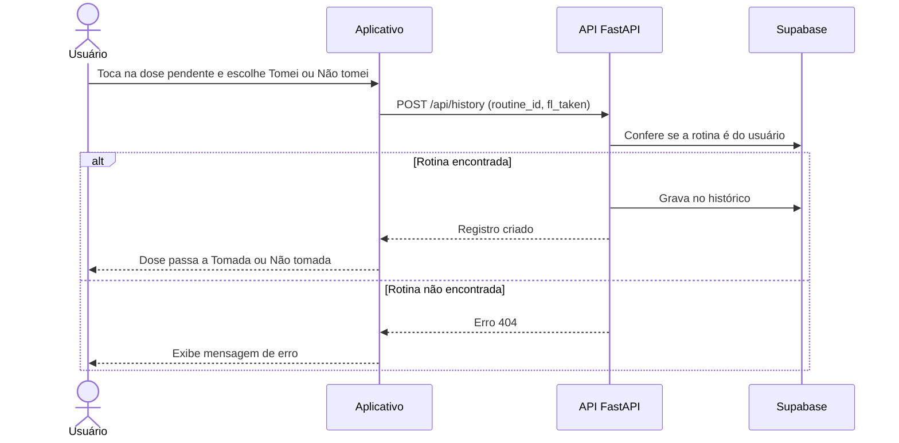
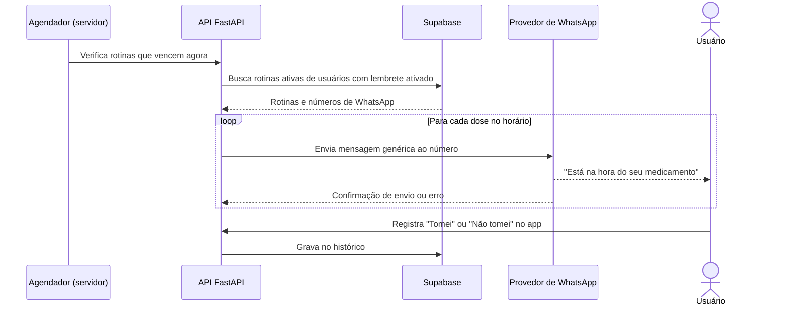
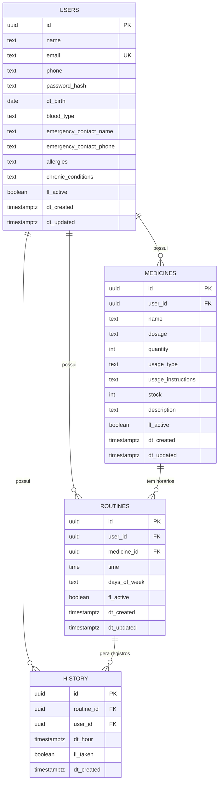

# Diagramas - MedControl

> Fluxogramas e diagramas que descrevem o funcionamento, a arquitetura e os dados do aplicativo, conforme o código atual.

A fonte do modelo de dados é o `backend/tables.sql`. Se o banco mudar, atualize este documento no mesmo Pull Request.

## Arquitetura

Situação atual: o app usa dados de teste e ainda não chama a API.

As linhas tracejadas ainda **não estão ligadas**. Os lembretes por WhatsApp partem do servidor; as notificações e o calendário do celular são tratados no próprio aparelho.

## Casos de uso

## Fluxograma: cadastro e login

Fluxo do back-end. A tela de login do app precisa ser confirmada.

## Fluxograma: status da dose

O status de cada dose de hoje é calculado no app. O banco só guarda o que **aconteceu** (histórico).

## Fluxograma: registro de dose

O registro **não desconta o estoque**. O estoque só muda quando a pessoa usa os botões de + e - em Medicamentos. Os lembretes (WhatsApp, notificações do celular e agendas) ainda não existem.

## Fluxograma: gestão de medicamentos

## Diagrama de sequência: login

## Diagrama de sequência: registro de dose

Sequência prevista para quando o app estiver integrado.

## Diagrama de sequência: lembrete por WhatsApp (planejado)

Ainda **não implementado**. Mostra o fluxo previsto quando o envio for criado.

O lembrete **não registra** a dose: quem registra é a pessoa, no app. A mensagem não cita o nome do medicamento (veja [privacidade.md](./privacidade.md)).

## Modelo entidade-relacionamento

Conforme `tables.sql`. As tabelas `users`, `medicines` e `routines` usam exclusão lógica (`fl_active`); `history` não tem esse campo.

Restrições do banco: `quantity > 0`, `stock >= 0` e `users.email` único.

> Os diagramas representam o escopo do MVP. O modo cuidador, as consultas e receitas, as recompensas, os lembretes (WhatsApp e notificações do celular) e a integração com agendas serão adicionados quando forem desenvolvidos. O diagrama de lembrete por WhatsApp acima é uma previsão.
